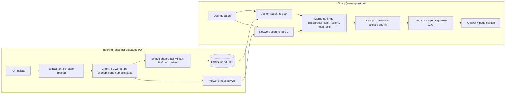

# RAG Document Chatbot

Upload a PDF and ask questions about it. Answers are generated only from the document, come with the page numbers they were retrieved from, and the bot says so when the document does not contain the answer. The project includes an evaluation harness, and the retrieval settings were chosen by measuring them instead of guessing.

**Live demo:** https://your-app-name.streamlit.app *(replace with your real link)*

## Features

- PDF upload with page-by-page text extraction
- Overlapping word chunks (60 words, 15 overlap) that remember which page they came from
- **Hybrid search:** vector similarity (sentence-transformer embeddings + FAISS) and keyword search (BM25), merged with Reciprocal Rank Fusion
- Grounded answers from a Groq-hosted LLM, with a refusal when the document has no answer
- "Best match: page(s) ..." caption under every answer
- Index cached per uploaded file, so the PDF is embedded once and not on every question
- Evaluation harness for retrieval, answer quality, latency, and faithfulness, with two fictional test documents

## Architecture



| Component | Choice |
|---|---|
| UI | Streamlit |
| PDF parsing | pypdf |
| Embeddings | `sentence-transformers/all-MiniLM-L6-v2` (normalized, so inner product equals cosine similarity) |
| Vector index | FAISS `IndexFlatIP` (exact search) |
| Keyword index | BM25 (`rank-bm25`) |
| Merging | Reciprocal Rank Fusion, 30 candidates from each search, top 8 sent to the LLM |
| LLM | Groq, model set by the `GROQ_MODEL` setting, temperature 0 |

## Project structure

```
.
├── app.py                  # Streamlit app
├── requirements.txt
├── .gitignore
├── .env.example            # copy to .env and add your key
├── README.md
├── data/
│   ├── rag_demo_company_handbook.pdf    # 3-page fictional handbook
│   └── northstar_operations_manual.pdf  # 105-page fictional manual (stress test)
├── eval/
│   ├── eval_rag.py         # evaluation harness (retrieval, answers, reranking)
│   ├── eval_extra.py       # latency, indexing time, faithfulness
│   ├── eval_set.json       # handbook: 15 answerable + 9 unanswerable questions
│   └── eval_set_long.json  # manual: 20 answerable + 6 unanswerable questions
└── docs/
    ├── DEPLOYMENT.md       # how to deploy on Streamlit Community Cloud or Cloud Run
    └── TEST_QUESTIONS.md   # guide to the 105-page manual test
```

## Setup

Requires Python 3.11 or 3.12 and a free [Groq](https://console.groq.com) API key.

```bash
# 1. Create and activate a virtual environment
python -m venv .venv
.venv\Scripts\activate          # Windows
# source .venv/bin/activate     # macOS / Linux

# 2. Install dependencies
pip install -r requirements.txt

# 3. Configure your key
copy .env.example .env          # Windows  (cp .env.example .env on macOS / Linux)
# then open .env and set GROQ_API_KEY

# 4. Run the app
streamlit run app.py
```

Open the URL Streamlit prints, upload a PDF, and ask a question.

## Evaluation

Both test documents are fictional, so every correct answer and its page are known. Each question lists the exact evidence text it must be found in. Run all commands from the `eval` folder.

```bash
cd eval

# Retrieval metrics (no API key needed)
python eval_rag.py --pdf ../data/northstar_operations_manual.pdf --eval-set eval_set_long.json --chunk-size 60 --overlap 15 --hybrid

# Answer quality (calls the LLM), with the settings the app uses
python eval_rag.py --pdf ../data/northstar_operations_manual.pdf --eval-set eval_set_long.json --generate --chunk-size 60 --overlap 15 --hybrid --top-k 8

# Compare chunk sizes
python eval_rag.py --pdf ../data/northstar_operations_manual.pdf --eval-set eval_set_long.json --sweep --hybrid

# Latency, indexing time, and faithfulness (calls the LLM)
python eval_extra.py --pdf ../data/northstar_operations_manual.pdf --eval-set eval_set_long.json
```

**Metrics**
- **hit@k:** the share of questions whose evidence appears in the top k retrieved chunks.
- **MRR:** the average of 1/rank of the first correct chunk (1.0 means always first).
- **Answer correctness:** keyword checks on the answer text.
- **Refusal accuracy:** unanswerable questions pass only if the bot refuses.
- **Faithfulness:** an LLM judge checks whether each answer's claims are supported by the retrieved chunks.
- **Latency:** P50, P75, and P95 of retrieval and generation time.

### Test 1: short handbook (3 pages, 17 chunks at 60/15)

| Stage | Result |
|---|---|
| Correct answers | 15/15 |
| Correct refusals | 9/9 |
| Faithfulness (judge, 3 runs) | 15/15 supported in each run |
| Latency P50 / P75 | 5.7 to 6.8 s / 6.3 to 7.7 s (3 runs) |
| Indexing | 0.3 to 0.6 s |

Earlier, with vector search and 180-word chunks, the handbook had 80% hit@1 and 100% hit@3. The first answer run had one failure, a question about parental leave days. The handbook says leave is "as per local law", and the model refused instead of saying so. Retrieval had found the right chunk, so this was a generation problem. One added prompt line fixed it, with no new refusal failures.

### Test 2: long manual (105 pages, 57,000 words, 20 answerable questions)

This is the harder test: 1,268 chunks at 60 words, with look-alike hub profiles, three similar incident-reporting rules, tables, and mostly filler text.

**Retrieval (vector search, 180/40 chunks, top 3)**

| Configuration | hit@1 | hit@3 | MRR |
|---|---|---|---|
| Vector search | 55% | 70% | 0.64 |
| Hybrid search | 75% | 90% | 0.85 |

**Chunk size with hybrid search (top 3)**

| Chunk / overlap (words) | Chunks | hit@1 | hit@3 | MRR |
|---|---|---|---|---|
| 60 / 15 | 1,268 | 85% | 95% | 0.93 |
| 100 / 20 | 713 | 75% | 90% | 0.85 |
| 180 / 40 | 408 | 75% | 90% | 0.85 |
| 250 / 50 | 286 | 75% | 80% | 0.82 |

**Reranker test (60/15, hybrid, cross-encoder over 30 candidates)**

| Configuration | hit@1 | hit@3 | hit@5 | MRR | Correct answers (top 8) |
|---|---|---|---|---|---|
| Hybrid, no reranker | 85% | 95% | 95% | 0.93 | 20/20 |
| Hybrid + reranker | 90% | 95% | 100% | 0.96 | 20/20 |

The reranker improved the ranking, but the final answers were the same with or without it, so it is not used in the app.

**Final app settings (60/15, hybrid, top 8)**

| Stage | Result |
|---|---|
| Correct answers | 20/20 in the measured run |
| Correct refusals | 6/6 |
| Faithfulness (judge) | 20/20 in one run; 19/20 in an earlier run, where the flagged answer was a judge error (the context had a table split across chunks) |
| Latency P50 / P75 / P95 | 6.6 / 7.7 / 8.0 s in one run; generation P50 5.6 to 6.6 s across two runs |
| Retrieval latency | 0.02 to 0.03 s on 1,268 chunks |
| Indexing | 19 to 22 s for 1,268 chunks |
| Context per question | about 476 words |

A P95 of 67.8 s appeared once in an earlier run, which was a single slow API response, not a retrieval problem.

### Limits of this evaluation

- **The settings were chosen using the same questions that report the results,** so the 20/20 is optimistic. The reranker and the chunk size decisions were made on those questions too.
- Both documents are synthetic and small. One question moves a score by 5 to 7 points.
- The manual's questions share exact words with its text, which favors keyword search. Real PDFs with paraphrased questions will probably show a smaller hybrid gain.
- Answer correctness uses keyword matching, which can miss a correct answer phrased differently.
- The faithfulness judge is the same model that wrote the answers, so it is a lenient check.
- Latency depends on Groq's load, so the results are approximate.

## Known limitations

- Scanned or image-only PDFs are not supported (no OCR).
- Tables are flattened to text, so a table row can end up split across chunks.
- The page caption shows which pages the retrieved text came from, not necessarily the page of the exact sentence used.
- Chunking is by word count, not by tokens or document structure.
- Broad questions like "summarize this document" are not tested and are expected to be weak, because only 8 chunks reach the model.
- The answer is returned all at once; there is no streaming yet.
- One document at a time; no conversation memory beyond the displayed chat.
- No authentication or rate limiting, so anyone with a public link uses your API quota.

## Possible improvements

- Streaming responses (show the answer as it is generated) and measuring time to first token
- Structure-aware chunking (headings and paragraphs) and table-aware parsing
- A fresh test set of paraphrased questions, scored once without tuning
- LLM-judge answer relevance and a second, independent judge model
- Multi-document support and authentication
